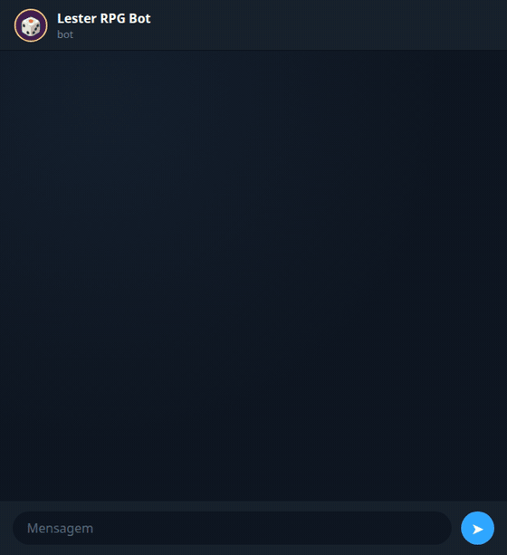

<div align="center">



<br>

[](https://t.me/RPGSilverBot)


<br>

### 🏮 A taverna está aberta. Escaneie e entre. 🏮

<a href="https://t.me/RPGSilverBot">
  
</a>

<sub>Ou toque aqui: <b><a href="https://t.me/RPGSilverBot">t.me/RPGSilverBot</a></b></sub>

</div>

<br>

## 📜 O Pergaminho

O **Lester RPG Bot** é o ajudante de mesa que todo Mestre (e todo jogador) queria ter. Em vez de folhear livros no meio da sessão, você pede e ele responde, **em português** e na hora, dentro do Telegram. Sem site, sem app, sem cadastro.

> *"Roll for initiative!"* 🎲

<div align="center">



<sub>As respostas acima são as reais do bot.</sub>

</div>

---

## 🗺️ Comece sua jornada em 30 segundos

| | |
|:-:|---|
| **1** | 📱 **Escaneie o QR Code** acima, ou toque em **[t.me/RPGSilverBot](https://t.me/RPGSilverBot)** |
| **2** | ▶️ Aperte **Iniciar** (`/start`) |
| **3** | 🍻 Use os botões do menu e comece a jogar |

> 💡 Também funciona em **grupos**: adicione o bot à mesa do seu grupo e use os comandos com `/comando`.

---

## 🧾 Ficha do Personagem

<div align="center">

| 👹 Monstros | 🐾 Feras | 📜 Feitiços | 🎓 Classes | 🧬 Raças |
|:-:|:-:|:-:|:-:|:-:|
| **77** | **32** | **319** | **12** | **9** |

*tudo em PT-BR, baseado no SRD 5e*

</div>

---

## ⚔️ Arsenal do Aventureiro

### 🎲 Para todos na mesa

| Comando | O que faz |
|---|---|
| `/roll 2d6+3` | Rola qualquer combinação de dados, com **vantagem** e **desvantagem** (`/roll d20 adv`) |
| `/spell` · `/spell fireball` | **Grimório** com 319 feitiços, filtrados por classe e nível. Aceita o nome em PT ou EN |
| `/class` · `/class mago` | Guia das **12 classes**: dados de vida, proficiências e progressão por nível |
| `/racas` | Guia das **9 raças**, com bônus e ônus de cada uma |
| `/item` | Um item aleatório para o bolso (ou para a bagunça) do aventureiro |

### 🧙 Para o Mestre

| Comando | O que faz |
|---|---|
| `/monster` · `/monster goblin` | **Bestiário** com ND, defesa, PV, atributos e ataques. Filtre por ND ou tipo |
| `/beast` · `/beast lobo` | **Feras** e animais para druidas, rangers e encontros na estrada |
| `/dungeon` | **Dungeon completa** pelo nível do grupo: ambiente, missão, monstros, baú d12 e obstáculos com CD |
| `/npc` | NPC pronto para a mesa: nome, raça, classe e atributos |
| `/loot` | Tesouro: moedas, item comum e item mágico |
| `/clima` | Clima sorteado, com efeitos de jogo |
| `/menu` | Abre o menu com botões para tudo isso |

### ✨ Exemplos

```text
/roll 3d8+2          → rola 3d8 e soma 2
/roll d20 adv        → duas rolagens, fica a maior 🏆
/monster goblin      → ficha completa do monstro
/spell bola de fogo  → descrição, alcance, duração e dano
/class paladino      → o guia da classe
```

> 📏 Alcances e deslocamentos já vêm convertidos para **metros**. 🔘 Quase tudo se resolve com **botões**, sem decorar comando.

---

<details>
<summary><b>🛠️ Quer hospedar o seu próprio bot? (opcional)</b></summary>

<br>

O bot público já está no ar, então **não precisa instalar nada** para jogar. Mas se você quiser rodar uma cópia sua:

1. Crie um bot no [@BotFather](https://t.me/BotFather) e copie o token.
2. Clone e configure:

   ```bash
   git clone https://github.com/PirataZang/botrpg.git
   cd botrpg
   cp .env.example .env      # coloque seu TELEGRAM_TOKEN no .env
   ```

3. Suba com **Docker**:

   ```bash
   docker compose up -d --build
   ```

   ou direto com **Node.js**:

   ```bash
   npm ci --omit=dev
   node bot.js
   ```

> 🔒 Nunca publique seu token. O `.env` já está no `.gitignore`.

</details>

---

<div align="center">

### 🎲 Que os dados estejam sempre a seu favor 🎲

Feito com ☕ e muitos críticos por **[PirataZang](https://github.com/PirataZang)**

<sub>Conteúdo de regras baseado no SRD 5e.</sub>

</div>
